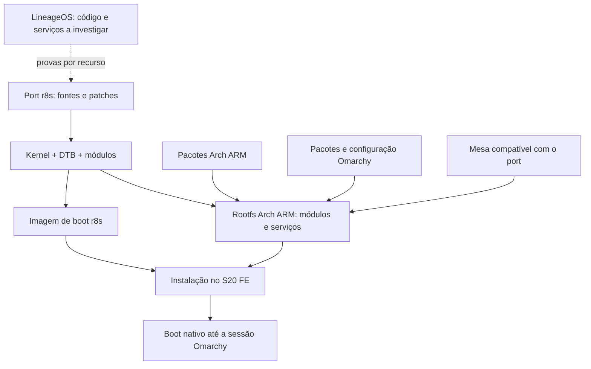

# Mapa de integração e reaproveitamento

Alvo: SM-G780F / Exynos 990. Complemento ao roadmap elaborado em 16/11/2026. Pesquisa documental; hipóteses ainda não testadas no aparelho. Links de branches são mutáveis.

## O que já existe e qual trabalho resta

| Camada | De onde aproveitar | Trabalho proposto |
| --- | --- | --- |
| Boot do Linux | Cadeia e ferramentas do port r8s | Reproduzir e empacotar; preservar recuperação |
| Kernel e descrição do hardware | `kernel/` do port e dependências indicadas pelo autor | Manter patches/configuração e compilar o conjunto |
| Aceleração gráfica | Kernel e `mesa/` do port | Integrar bibliotecas e testar o compositor escolhido |
| Integração do aparelho | Serviços e configurações em `device/` | Revisar quais dependem do Debian e adaptar para a base final |
| Sistema de arquivos inicial | Ferramentas em `tools/` | Reproduzir referência Debian e preparar rootfs Arch ARM separado |
| Desktop e aplicações | Omarchy | Resolver versões/pacotes ARM e dependências do ambiente |
| Uso por toque | Configuração do desktop + componentes compatíveis a selecionar | Escala, teclado virtual, controles e navegação acessíveis |
| Instalação e atualização | Ferramentas existentes dos dois projetos | Integrar sem substituir inadvertidamente kernel, DTB ou boot r8s |
| Recursos ainda ausentes | Investigar implementação Android/LineageOS e trabalho mainline existente | Escolher port de código, serviço de compatibilidade ou desenvolvimento necessário |

Os diretórios e o objetivo do port estão no [repositório r8s](https://github.com/bshbsh404/galaxy-s20fe-mainline-linux). A base Omarchy está descrita na [pesquisa ARM64](02-omarchy-arm64.md). A coluna de trabalho é nossa proposta, não uma funcionalidade entregue pelos upstreams.

**A integração de hardware já existente é o ponto de partida.** As etapas M1/M2 reproduzem esse trabalho; M3/M4 conectam o ambiente gráfico e a base de pacotes desejados. Desenvolver novamente drivers que já funcionam não faz parte do plano.

## Como a mistura resulta em um sistema instalado

A integração acontece em arquivos e interfaces concretos:

1. O build do port fornece kernel, DTB e módulos; o empacotamento r8s prepara a imagem de boot para a cadeia do aparelho.
2. Um rootfs novo fornece Arch ARM, systemd, bibliotecas, pacman e usuários. Ele recebe os módulos compatíveis e os serviços necessários ao hardware.
3. Mesa e o conjunto gráfico compatível conectam os drivers do kernel ao compositor.
4. Pacotes/configurações do Omarchy fornecem sessão, shell, ferramentas e aplicações. A configuração móvel completa o uso por toque.
5. A instalação grava os artefatos corretos nos destinos verificados. Ao ligar, o kernel inicia o systemd desse rootfs, que oferece a sessão gráfica.

O gráfico é a arquitetura proposta. Detalhes do caminho de boot e destinos estão em [05](05-build-e-instalacao.md). A seta LineageOS não implica copiar seu kernel ou executar seus serviços junto: representa investigação e adaptações individuais aprovadas.

Há **um kernel ativo e um rootfs de produção** nessa rota. Debian é uma referência separada; pacotes Debian não entram no banco do pacman. “Imagem no formato Android” descreve um contêiner de boot, não exige que Android/LineageOS rode dentro dele. Ao trocar o rootfs, validar cmdline, montagem da raiz e módulos, mesmo preservando o kernel.

## O que existe no LineageOS

Há uma árvore específica para o [SM-G780F/r8s](https://github.com/LineageOS/android_device_samsung_r8s). Ela depende de `universal9830-common`, que por sua vez referencia o kernel Samsung e componentes de hardware Exynos. Isso fornece código e configuração concretos para investigar, sem comprovar que cada recurso funciona fora do Android. [Dependência r8s](https://github.com/LineageOS/android_device_samsung_r8s/blob/lineage-24.0/lineage.dependencies), [dependências comuns](https://github.com/LineageOS/android_device_samsung_universal9830-common/blob/lineage-24.0/lineage.dependencies).

Android usa Linux como kernel, mas funções de hardware também podem depender de HALs e serviços Android. Uma HAL expõe o dispositivo por uma interface própria; serviços podem se comunicar por Binder. Logo, portar o driver do kernel pode ser apenas parte do trabalho. [Arquitetura HAL do Android](https://source.android.com/docs/core/architecture/hal).

Exemplo conceitual: se uma câmera depende de driver, firmware e serviço Android, copiar o driver não entrega automaticamente uma câmera utilizável pelos aplicativos do desktop. Identificar essa cadeia para a câmera deste aparelho ainda é uma tarefa pendente, não um diagnóstico já concluído.

## Duas rotas possíveis

**A — Port Linux existente + Omarchy (rota inicial recomendada).** Manter boot, kernel e gráficos do projeto r8s; integrar base ARM64 e desktop. Consultar LineageOS para preencher lacunas, portando código e interfaces quando viável. A vantagem esperada é aproveitar a base que já foi demonstrada com uma distribuição Linux. As limitações de hardware permanecem até serem resolvidas.

**B — Base Android/LineageOS + adaptação para Linux (alternativa a investigar).** O libhybris permite aproveitar bibliotecas Android em processos Linux e descreve uma base Android reduzida, serviços e adaptações adicionais; Halium organiza esse tipo de integração. Não é apenas trocar a imagem de boot. [Projeto libhybris](https://github.com/libhybris/libhybris).

Não foi comprovada aqui uma combinação pronta de Halium, r8s, versão do LineageOS e Hyprland/Omarchy. Essa rota pode aproveitar mais da implementação Android, mas requer validar a pilha inteira, especialmente a saída gráfica. Não prometer que ela recuperará automaticamente áudio, câmeras ou modem.

## Como decidir por recurso

1. Localizar implementação e dependências nas fontes do dispositivo e kernel Android.
2. Comparar com o suporte existente no port Linux: interfaces, firmware e serviços necessários.
3. Propor a menor prova que entrega o recurso em um aplicativo real.
4. Medir funcionamento e regressões, registrar versões e só então incorporar ao sistema.

O rastreamento técnico inicial agora está em [05 — build](05-build-e-instalacao.md), [06 — pacotes](06-pacotes-e-desktop.md) e [07 — LineageOS](07-lineage-e-drivers.md). [08](08-contratos-e-validacao.md) define as evidências exigidas. A pesquisa determina o caminho; SHAs finais, artefatos e testes precisam ser produzidos durante a execução.
